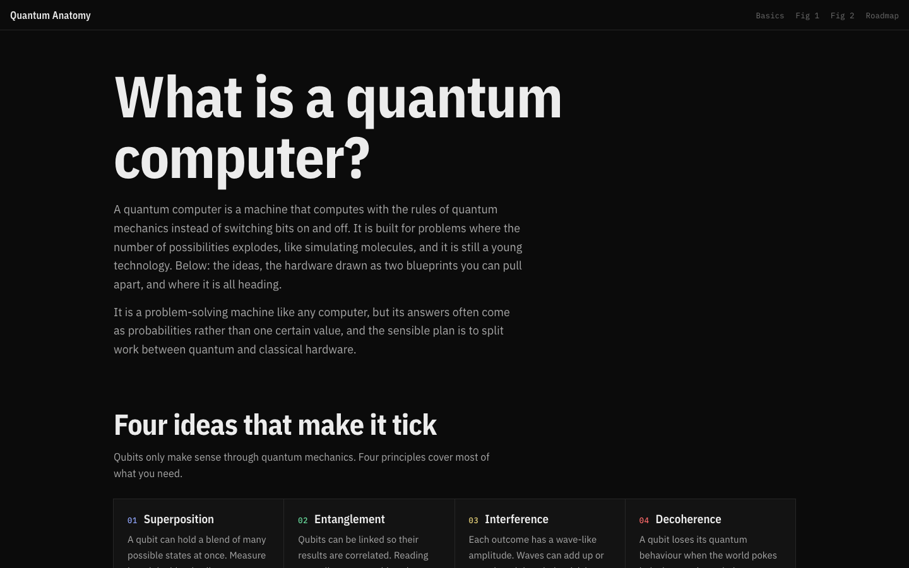

# Quantum Anatomy

> An interactive explainer on what a quantum computer is, with two 3D isometric blueprints you can pull apart: the dilution refrigerator (Fig 1) and the qubit chip package (Fig 2).



Built by [Anas Aslam](https://github.com/4pfanas) as a portfolio piece. Plain HTML, CSS and JavaScript. No libraries, no build step, a single `index.html`.

## What is in it

The page is one scroll, nine sections:

| Section (`id`) | Content |
| --- | --- |
| What is a quantum computer? (`what`) | Plain-language definition and why answers often come as probabilities |
| Four ideas that make it tick (`principles`) | Superposition, entanglement, interference, decoherence |
| How do quantum computers work? (`qubits`) | A **qubit slider (1–100)** that shows how combinations double with each qubit, plus ways to build a qubit |
| Quantum computing components (`components`) | Processor, superconductors, control, software |
| **Fig 1: The machine** (`fig1`) | A 3D isometric dilution refrigerator, six temperature stages from 300 K down to about 15 mK |
| **Fig 2: The chip package** (`fig2`) | A 3D isometric processor package with eight qubits you can play |
| Classical versus quantum (`compare`) | Comparison table and when quantum is actually better |
| What it could be used for (`uses`) | Pharmaceuticals, chemistry, machine learning |
| Utility, advantage and the road ahead (`roadmap`) | The two milestones, how progress is measured, six challenges |
| The numbers behind the drawings (`facts`) | Attenuation table, why so cold, what the drawings simplify, sources |

## The two interactive figures

### Fig 1: the dilution refrigerator

A stack of plates, each colder than the one above. Control and readout cables pass through every plate.

- **Drag** to orbit, **click a stage** to read its temperature, role and cooling power.
- **Pull apart** slider separates the stages so you can see each plate.
- **Vacuum can** toggle hides or shows the outer shell.
- **Slow turn** toggle starts or stops the idle rotation.
- **Send a program** animates a job travelling through the machine: control pulses going down, readout tone going down, readout reply coming up. Support rods are marked in the legend.

### Fig 2: the chip package

A silicon die with qubits, couplers and resonators, wire-bonded to a board, bolted into a copper holder, under a shield.

- **Drag** to orbit, **click a qubit or layer** to select it. The readout shows the qubit and its state (for example `q0 · |0⟩ · idle`).
- **Pull apart** slider separates the layers.
- Gate buttons act on the selected qubit: **X pulse**, **Half pulse (H)**, **Entangle with next**, **Measure all**, **Reset**.
- **Highlight** lets you emphasise a layer group.

The qubit demo is a classical stand-in for ideal gates on a handful of qubits. It follows the rules (superposition collapses on measurement, an entangled pair gives matching or opposite results) but does not simulate noise.

## Accuracy notes

- Stage temperatures, attenuation and component values are typical figures and vary by lab. Total attenuation from room temperature to the chip is about 56 dB in the wiring shown, so a 1 mW pulse arrives near 2.5 nW.
- Real fridges have more plates, far more cables (hundreds to thousands per machine at scale) and extra filtering and thermal anchoring that the drawing leaves out. Cell sizes, plate radii and the chip layout are schematic.
- Dates, targets and market forecasts (for example IBM's 2029 and 2033 logical-qubit goals) are IBM's own claims, paraphrased, and are labelled as estimates on the page.

## Sources

- IBM Think, [What is quantum computing?](https://www.ibm.com/think/topics/quantum-computing): topic list, definitions and roadmap claims. The text is paraphrased.
- RF Essentials, [required attenuation at each temperature stage of a dilution refrigerator](https://rfessentials.com/rf-knowledge-base/what-is-the-required-attenuation-at-each-temperature-stage-of-a-dilution-refrige/): stage temperatures, per-stage attenuation, readout chain order.
- RF Essentials, qubit readout chains: amplifier gain and noise figures.
- Isometric plate style after the RTX Spark anatomy drawing supplied with the brief.

Independent project, not affiliated with IBM.

## Run it

Open `index.html` in a browser, or serve the folder:

```bash
npx serve .
# or
python3 -m http.server 8000
```

Google Fonts (IBM Plex Sans, Sans Condensed and Mono) load from the network; the page still works without them.

## Deploy

Drag the folder into Vercel, or from the folder run `vercel --prod`. Any static host works.

## Project structure

```
index.html        the whole site: markup, styles, SVG figures and scripts
docs/screenshots  images used in this README
```

## Accessibility

Sliders and toggle buttons have labels and `aria-pressed` state, and the page respects `prefers-reduced-motion`.

## Credit and licence

Site design and code: Anas Aslam. Source material credited above. No licence has been chosen yet, so all rights are reserved.
